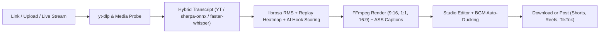

<div align="center">

<picture>
  <source media="(prefers-color-scheme: dark)" srcset="clipcut-logo.svg" />
  
</picture>

**Turn long-form videos, podcasts, and live streams into captioned, publish-ready short clips.**

[](https://github.com/Chethankumar443/ClipCut/actions/workflows/ci.yml)
[](LICENSE)
[](https://www.python.org/downloads/)

</div>

---

## Table of Contents

- [Overview](#overview)
- [How the Pipeline Works](#how-the-pipeline-works)
- [Key Features](#key-features)
- [Supported AI Providers](#supported-ai-providers)
- [Speech Recognition Models](#speech-recognition-models)
- [Quick Start (Local)](#quick-start-local)
- [Marketing Landing Page (`landing-page/`)](#marketing-landing-page-landing-page)
- [Docker & Production Deployment](#docker--production-deployment)
- [Configuration Reference](#configuration-reference)
- [Architecture](#architecture)
- [Testing & Maintenance](#testing--maintenance)
- [License](#license)

---

## Overview

**ClipCut** is a free, open-source, self-hosted video clipping studio built with **FastAPI**, **FFmpeg**, **yt-dlp**, **librosa**, and local or cloud AI models. Paste a **YouTube**, **Twitch**, or **Kick** link, upload a local video file (with chunked uploads for large files), or monitor live streams—ClipCut transcribes speech, detects vocal energy spikes and viewer replay peaks, scores hooks with your AI key, renders vertical/square/landscape clips with animated word-level captions, and lets you fine-tune timing, captions, and background music before downloading or publishing.

---

## How the Pipeline Works



---

## Key Features

### 1. Hybrid Link Ingestion & Chunked Uploads
- Downloads VODs and clips via `yt-dlp` with smart audio-first and range-only fetching for multi-hour podcasts.
- Supports resumable, multi-part uploads (`CLIPCUT_UPLOAD_PART_MB`, default `40 MB`) so large local files work cleanly behind reverse proxies and CDNs.

### 2. Vocal Energy, Most-Replayed & Personalized AI Scoring
- Uses `librosa.feature.rms()` to tag vocal energy spikes as `[HIGH ENERGY]` and `yt-dlp` viewer replay heatmaps as `[MOST REPLAYED]`.
- Evaluates opening hooks for curiosity gaps, bold claims, and pattern interrupts using your chosen AI provider.
- Learns from your 👍 / 👎 clip feedback to personalize future AI picks while still surfacing standout moments across the video.
- **Works without an AI key**: when no key is configured, ClipCut automatically falls back to loudness + speech-boundary detection.

### 3. Gaming Mode & Facecam Detection
- Detects 23+ popular games from stream titles, video titles, or creator settings (`studio/games.py`), tailors hooks/titles/hashtags (`GAME_RULES`), and counts unique chatters instead of raw message spam ([GAMING.md](GAMING.md)).
- Automatically locates facecams in gaming streams (`studio/facecam.py`) for split/framed vertical layouts.

### 4. Interactive Studio Editor & Real-Time Preview
- **Live Preview**: Switch between `9:16` (Shorts/Reels/TikTok), `1:1` (Square), and `16:9` (Landscape), caption styles (`Bounce`, `Hype`, `Clean`), layouts, and hook banners in real time before re-rendering.
- **Playhead-Synced Transcript**: Click any word to seek and set Start/End timestamps; double-click any word to fix caption spelling inline.
- **Background Music Mixer**: Pick a built-in starter track or upload your own MP3/WAV/M4A with volume control, fade-in/out, and FFmpeg `sidechaincompress` auto-ducking—rendered via `-c:v copy` for near-instant previews, with non-destructive reset.

### 5. Creators Hub & Live Auto-Clipping
- Monitor creators in a dedicated workspace, toggle automatic recording when they go live, and clip high-energy moments while the stream is still broadcasting (`studio/live.py`).

### 6. Direct Publishing, Feedback & Admin Controls
- Connect **YouTube** (Shorts), **Instagram** (Reels), and **TikTok** via OAuth in **Settings → Connected apps** to publish or schedule clips directly.
- Built-in **Send feedback** view (`/app/feedback`) with star ratings, topic categories, and admin review in `/admin`.
- Optional multi-user accounts (`CLIPCUT_ACCOUNTS=1`), fair multi-user job queue (`studio/jobs.py`), SQLite or PostgreSQL, and resource/load guards (`studio/load.py`).

---

## Supported AI Providers

Configure your AI provider in the dashboard (**Settings → AI**) or via `.env` (`CLIPCUT_AI_PROVIDER`, `CLIPCUT_AI_MODELS`, `CLIPCUT_AI_KEY`). Dashboard settings take precedence over `.env`.

| Provider ID | Service | Example Model | Key / Setup |
| :--- | :--- | :--- | :--- |
| `gemini` | Google Gemini | `gemini-2.5-flash` | [Google AI Studio](https://aistudio.google.com/apikey) |
| `openai` | OpenAI | `gpt-4o-mini` | [OpenAI API Keys](https://platform.openai.com/api-keys) |
| `xai` | xAI (Grok) | `grok-4` | [xAI Console](https://console.x.ai) |
| `groq` | Groq | `llama-3.3-70b-versatile` | [Groq Console](https://console.groq.com/keys) |
| `openrouter` | OpenRouter | Any listed model ID | [OpenRouter Keys](https://openrouter.ai/keys) |
| `anthropic` | Anthropic (Claude) | Current Claude model ID | [Anthropic Console](https://console.anthropic.com) |
| `ollama` | Local Ollama | `llama3.1` | No API key (`ollama pull llama3.1`) |
| `custom` | OpenAI-Compatible | Custom model ID | Set `CLIPCUT_AI_BASE_URL` |

> `CLIPCUT_AI_MODELS` accepts comma-separated model IDs tried in order as automatic fallbacks.

---

## Speech Recognition Models

ClipCut uses a layered transcription pipeline (`studio/transcribe.py`):

1. **Existing Transcripts**: Uses `youtube-transcript-api` or `yt-dlp` captions when available (`CLIPCUT_YT_TRANSCRIPT=1`).
2. **Local English ASR (`sherpa-onnx`)**: Downloads the English Parakeet 0.6b speech model (~480 MB) automatically on first start, or ahead of time with:
   ```bash
   python -m studio.fetch_model
   ```
3. **Multilingual / Arabic (`faster-whisper`)**: Supports multilingual transcription, plus Hindi/Urdu Romanized captions (`studio/roman.py`).
4. **Remote GPU ASR Worker**: Offload transcription to a dedicated GPU machine using `studio/asr_worker.py` and `deploy/gpu/`.

---

## Quick Start (Local)

### 1. Prerequisites
- **Python 3.10+**
- **FFmpeg & FFprobe** (bundled automatically via `static-ffmpeg` in `requirements.txt`, or install system-wide via `winget install Gyan.FFmpeg`, `brew install ffmpeg`, or `sudo apt install ffmpeg`).

### 2. Clone & Install

> **Windows note:** Install into a short path such as `C:\clipcut` to avoid Windows' 260-character path limit when loading native speech libraries.

```bash
git clone https://github.com/Chethankumar443/ClipCut.git C:\clipcut   # or ~/clipcut on macOS/Linux
cd C:\clipcut
pip install -r requirements.txt
```

### 3. Configure & Run

```bash
cp .env.example .env
python -m studio.server
```

Open **http://127.0.0.1:8765** in your browser. By default (`CLIPCUT_ACCOUNTS=0`), ClipCut opens straight into the studio dashboard without requiring sign-in.

To run an isolated test instance without touching your main data folder:

```bash
CLIPCUT_DATA=./tmp-data CLIPCUT_PORT=8766 python -m studio.server
```

---

## Marketing Landing Page (`landing-page/`)

The [landing-page/](landing-page) folder contains a standalone **Astro + React + Tailwind CSS v4 + shadcn + React Bits** product site:

```bash
cd landing-page
npm install --legacy-peer-deps
npm run dev
```

Build static assets with `npm run build`. All Node packages stay isolated inside `landing-page/node_modules`.

---

## Docker & Production Deployment

ClipCut ships with a production 3-container stack (**app**, **PostgreSQL**, and **Caddy** for automatic HTTPS):

```bash
cp .env.example .env
# Set CLIPCUT_DOMAIN, POSTGRES_PASSWORD, and COMPOSE_PROFILES=own-https in .env
docker compose up -d --build
```

Promote your first user to admin (the `/admin` dashboard returns 404 to non-admins):

```bash
docker compose exec app python -m studio.admin grant you@example.com
```

See [DEPLOY.md](DEPLOY.md) for full instructions on:
- Reverse-proxying behind an existing **Nginx** ([deploy/nginx-clipcut.conf](deploy/nginx-clipcut.conf)) or **Traefik** ([deploy/docker-compose.traefik.yml](deploy/docker-compose.traefik.yml))
- **Cloudflare** Origin certificates (`deploy/Caddyfile.origin`)
- Configuring **Google OAuth**, **YouTube Data API v3**, **Instagram**, **TikTok**, and **SMTP** email verification
- Deploying a dedicated **GPU ASR worker** ([deploy/gpu/](deploy/gpu))

---

## Configuration Reference

All settings are read from `.env` or environment variables (see [.env.example](.env.example) for full comments):

| Variable | Default | Description |
| :--- | :--- | :--- |
| `CLIPCUT_DATA` | `./data` | Storage folder for videos, clips, SQLite DB, and speech models |
| `CLIPCUT_PORT` | `8765` | HTTP port for the studio server |
| `CLIPCUT_PUBLIC_URL` | `http://127.0.0.1:8765` | Public base URL (used for OAuth callbacks and email links) |
| `DATABASE_URL` | *(empty → SQLite)* | Optional PostgreSQL URL (`postgresql+psycopg://...`) |
| `CLIPCUT_ACCOUNTS` | `0` (Docker: `1`) | Enable multi-user sign-up and login |
| `CLIPCUT_AI_PROVIDER` | `gemini` | Default AI provider (`gemini`, `openai`, `xai`, `groq`, `openrouter`, `anthropic`, `ollama`, `custom`) |
| `CLIPCUT_AI_MODELS` | *(empty)* | Comma-separated model IDs (fallback order) |
| `CLIPCUT_AI_KEY` | *(empty)* | Provider API key (or `CLIPCUT_AI_KEY_FILE` for Docker secrets) |
| `CLIPCUT_JOB_WORKERS` | CPU count | Max concurrent video processing jobs |
| `CLIPCUT_MAX_LIVE` | `2 × CPU count` | Max concurrent live stream recordings |
| `CLIPCUT_UPLOAD_PART_MB` | `40` | Chunk size for resumable browser uploads |
| `CLIPCUT_ALLOWED_SITES` | `youtube.com,youtu.be,twitch.tv,kick.com` | Allowed link domains |

---

## Architecture

| Path | Purpose |
| :--- | :--- |
| [studio/server.py](studio/server.py) | FastAPI routes, auth/rate-limit middleware, media streaming, and admin endpoints |
| [studio/config.py](studio/config.py) | Environment-backed configuration and secret file loading |
| [studio/jobs.py](studio/jobs.py) | Fair multi-user job queue, video pipeline orchestration, and audio-mix helpers |
| [studio/media.py](studio/media.py) | `yt-dlp` ingestion, `youtube-transcript-api`, `librosa` energy & replay heatmap extraction |
| [studio/transcribe.py](studio/transcribe.py) | Hybrid ASR (`sherpa-onnx`, remote GPU worker, and `faster-whisper`) |
| [studio/fetch_model.py](studio/fetch_model.py) | Speech model registry (`MODELS`) and verified downloader |
| [studio/brain.py](studio/brain.py) | Prompt engineering, `[HIGH ENERGY]` / `[MOST REPLAYED]` tagging, and taste profile |
| [studio/render.py](studio/render.py) | Multi-aspect FFmpeg rendering (`9:16`, `1:1`, `16:9`), ASS captions, and BGM auto-ducking |
| [studio/ai.py](studio/ai.py) | Unified client for Gemini, Ollama, OpenRouter, OpenAI, Anthropic, Groq, and xAI |
| [studio/live.py](studio/live.py) | Live stream monitoring, rolling buffer recording, and real-time clipping |
| [studio/games.py](studio/games.py) & [studio/facecam.py](studio/facecam.py) | Game title detection, gaming copy rules, and webcam bounding-box detection |
| [studio/posting.py](studio/posting.py) & [studio/accounts.py](studio/accounts.py) | OAuth connection & publishing for YouTube Shorts, Instagram Reels, and TikTok |
| [studio/db.py](studio/db.py) | SQLAlchemy Core schema for SQLite and PostgreSQL |
| [web/index.html](web/index.html) | Single-file, zero-build studio web application |
| [landing-page/](landing-page) | Standalone Astro + React + Tailwind CSS v4 + React Bits marketing site |
| [tools/](tools) | Safe dependency & media updaters (`update_requirements.py`, `update_media_deps.py`) |
| [tests/](tests) | Automated integration test suite (`python tests/run.py`) |

---

## Testing & Maintenance

Run the full automated test suite against an isolated temporary data directory (no API keys required):

```bash
python tests/run.py
```

Keep `yt-dlp`, `youtube-transcript-api`, `static-ffmpeg`, and Python dependencies up to date with automatic verification and rollback on failure:

```bash
python tools/update_requirements.py --check   # preview available updates
python tools/update_requirements.py           # update & verify (rolls back on failure)
```

---

## License

Released under the [MIT License](LICENSE). Copyright © 2026 Chethan Kumar Jagadish Ulavi.
